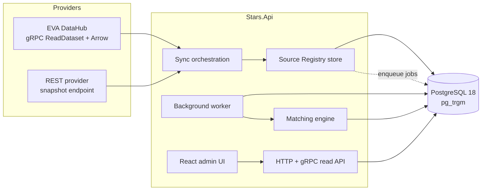

# STARS architecture (production v1)

PlantUML diagrams live in [docs/diagrams](diagrams/README.md):

- [system components](diagrams/01-system-components.puml)
- [deployment](diagrams/02-deployment.puml)
- [sync and matching algorithm](diagrams/03-sync-and-matching.puml)
- [use cases and requests](diagrams/04-use-cases.puml), [request flows](diagrams/05-request-flows.puml)
- [core data model](diagrams/06-data-model.puml)

## 1. Components

One process is enough for a standard deployment: ASP.NET Core serves gRPC, HTTP, static admin
assets and one `BackgroundService` worker. The job queue is in PostgreSQL, so a separate
worker process can be added later without changing semantics.

Startup migrates the database and reconciles the declarative `Stars:Providers`
configuration. Reconciliation creates or updates provider connections and feeds by name
and feed key; it never touches cursors, links, candidates or sync history.

## 2. Source ingestion

Each connector returns `SourceBatch` pages. A page is processed in one transaction:

1. Upsert each `source_entity` by `(source_feed_id, entity_kind, source_key)`.
2. Compare `identity_hash`. On change, update the projection, close the previous current
   name and record the new name in `source_entity_names`.
3. Upsert events by `(source_feed_id, source_key)` and replace participants only when the
   compact `context_hash` changes.
4. Ignore stale observations: if `ObservedAt` is older than the stored `last_seen_at`,
   content is not overwritten and no job is enqueued.
5. Enqueue at most one idempotent job per entity per page.
6. Advance `sync_cursors` **in the same transaction**.

Because the cursor is committed with the data, a process crash can only replay a page.
Replay is harmless: hashes are deterministic and jobs use a unique key.

`identity_hash` covers entity kind, source key, external ID, normalised name, sport and
country. It deliberately excludes raw payloads and odds so a repeated provider snapshot
does not look like a change.

## 3. Data model

The production model reuses the Source Registry / Master Registry ERD:

| Table | Role |
| --- | --- |
| `provider_connections` | provider config; only a secret reference |
| `source_feeds` | independent stream (snapshot mode) |
| `sync_cursors`, `sync_runs` | resume points and run health |
| `source_entities` | searchable projection of provider entities |
| `source_entity_names` | observed name history and aliases |
| `source_events` | one compact row per fixture |
| `source_event_participants` | home/away team references |
| `master_entities`, `master_names` | canonical identity |
| `entity_links` | active/closed source→master links |
| `match_candidates` | scored targets (source or master) |
| `match_evidence` | versioned explanation per candidate |
| `match_decisions` | immutable audit of link/reject/create/unlink/review |
| `processing_jobs` | idempotent matching queue |

Key constraints:

- `source_entities (source_feed_id, entity_kind, source_key)` unique.
- `entity_links` partial unique index on `source_entity_id WHERE valid_to IS NULL` — one
  active canonical parent per source record.
- `match_candidates` check: exactly one of `candidate_source_entity_id` /
  `candidate_master_entity_id`.
- `processing_jobs` unique on `(source_entity_id, reason, input_hash, matcher_version)`.

## 4. Local candidate search

`pg_trgm` is enabled by migration. Normalised names are indexed with `gin_trgm_ops` on
both `source_entities.normalized_name` and `master_entities.normalized_name`.

Candidate generation does not scan all rows in memory:

1. If the source entity already has an active link, matching is skipped.
2. Query other feeds for exact normalised name or trigram similarity `%`.
3. Query canonical masters that have at least one active link.
4. Collapse source candidates that already have a master into that master.
5. Load compact context (opponents, kickoff, competition, home/away) for the top set.

Normalisation is deterministic: lower-case, Unicode decomposition, Cyrillic→Latin
transliteration, punctuation folding, U19/U21/women/reserve markers preserved, generic
club tokens removed, and a small explicit alias table (`Moscow`/`Moskva`,
`Dynamo`/`Dinamo`, `St`/`Sankt`, `CSKA`/`ЦСКА`).

## 5. Scoring and decision policy

The engine is pure and versioned (`teams-v1`). It is split conceptually into:

- `CandidateGenerator` — SQL above.
- `Scorer` — `MatchEngine.Score`.
- `DecisionPolicy` — `MatchEngine.Run`.

Weights:

| Component | Weight | Notes |
| --- | --- | --- |
| Name similarity | 0.65 | indel ratio + token-set ratio on normal forms |
| Sport | 0.10 | omitted when either side is unknown |
| Country | 0.05 | omitted when either side is unknown |
| Shared fixture context | 0.20 | opponent similarity, kickoff proximity, competition, home/away |

Components with no information are excluded and the remaining weights are renormalised.
Hard conflicts always force review:

- different squad markers (`u19`, `w`, `res`, `2`/`3`);
- different known sports;
- different known countries.

Automatic linking requires all of:

- top score ≥ 0.88;
- margin to second candidate ≥ 0.03;
- no hard conflict;
- a name with more than one token **or** a shared fixture context;
- no multiple teams in the source feed share the same normal form (otherwise
  `source_name_ambiguous` → review).

The last rules are why a bare `Динамо` cannot become canonical just because one provider
uses the same word. Two plausible `Динамо` candidates produce `ambiguous` and stay in
Review; several `Al Ittihad` records in one feed are not made unique by one bookmaker
candidate.

## 6. Link writing

Automatic link transaction:

1. Resolve or create the master. If the target is an unlinked source entity, a master is
   created from the current observation and the target is linked with a `create_master`
   decision.
2. Insert an `auto_link` decision containing score, margin, target and evidence summary.
3. Insert the source→master link.
4. Record both display names as master names.
5. Mark the top candidate `accepted`, supersede other pending candidates for this source.

Manual confirmation follows the same path with `decided_by = reviewer` and
`decision_type = manual_link`. If the source already has a different active link, the API
returns **409 Conflict** and does not rewrite history. Unlinking closes the link
(`valid_to = now()`) and appends an `unlink` decision; rows are retained.

## 7. Idempotency and incremental behaviour

- A replay of unchanged records inserts no jobs.
- New or changed entities enqueue an `identity` job with the new `identity_hash`.
- A changed event enqueues one combined `event_context` job per participating entity; if
  the entity itself changed in the same batch, its identity job already covers it.
- The worker leases with `FOR UPDATE SKIP LOCKED`, attempts at most 3 times, and marks
  failed jobs explicitly.
- If an entity is already linked, a later observation is a no-op for matching. Confirmed
  links are never re-pointed.
- A new event context creates a new job hash, so a previously unresolved match can be
  re-opened when new evidence arrives; a repeated identical event cannot.

## 8. Failure semantics

| Failure | Result |
| --- | --- |
| connector throws mid-page | sync run `failed`; previous cursor intact; page replay safe |
| process dies during ingestion transaction | transaction rolls back; cursor not advanced |
| process dies before job completes | lease expires; job retried |
| duplicate delivery | unique job key and identity hashes suppress duplicates |
| delayed/stale observation | content is not overwritten; no job is enqueued |
| provider has no change feed | manual bounded snapshots only; no timer polling |
| link conflict during confirm | 409; no silent replacement |

## 9. Observability

HTTP API exceptions use Problem Details: missing resources return 404, conflicting
links return 409, and invalid review transitions return 400. Unexpected failures return
500 without exposing internal exception messages in production.

- `/health/live` — process liveness.
- `/health/ready` and `/health/db` — PostgreSQL reachability.
- Health endpoints use ASP.NET Core Health Checks: plain-text `Healthy` (200) or
  `Unhealthy` (503); liveness does not query PostgreSQL.
- `/api/metrics` — source entities/events, providers, masters, active links, pending
  reviews, job states, failed runs, records read, average sync duration.
- OTLP metrics (ASP.NET Core + HTTP client) when `OTEL_EXPORTER_OTLP_ENDPOINT` is set.
- `sync_runs` stores per-run record counts, status, start/end and error text.
- `match_evidence` and `match_decisions` explain every automated and manual outcome.

## 10. Security boundaries

- Provider token is resolved from an environment variable named in
  `provider_connections.auth_secret_ref`; it is never persisted.
- Admin endpoints have no authentication in this release. Put them behind a trusted
  network or a reverse proxy before exposing them.
- gRPC uses cleartext h2c for local Compose. Use TLS between hosts.
- EVA and its schema/proto are not modified. The connector only calls `ReadDataset`.

## 11. Scaling notes

The deployment is intentionally single-writer/single-worker. The next safe steps are:
separate worker process, per-feed advisory locks, listing partitioning for very large
providers, and a read replica for search. None of them require changing the connector
contract or the canonical-link invariants.
