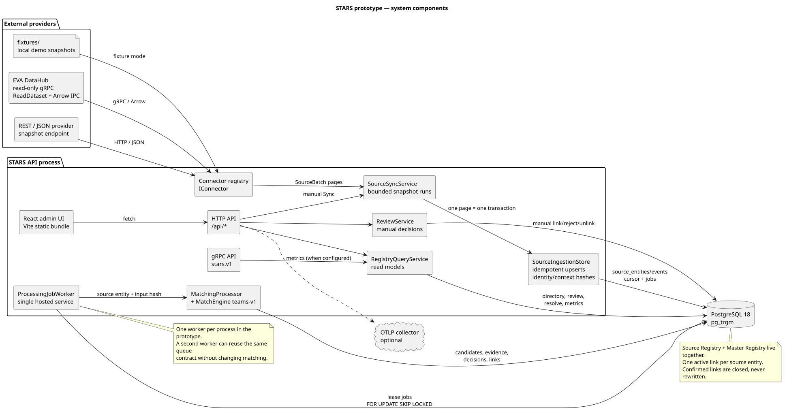
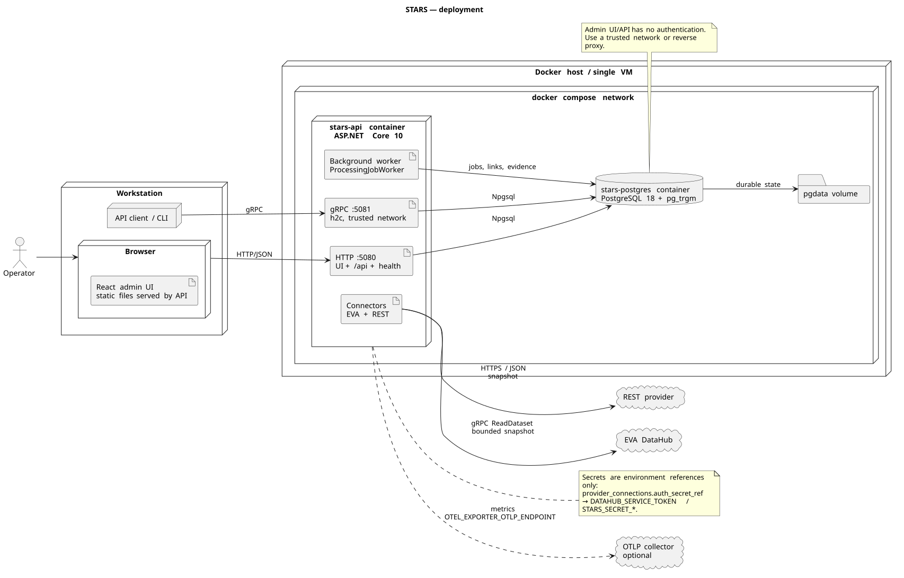
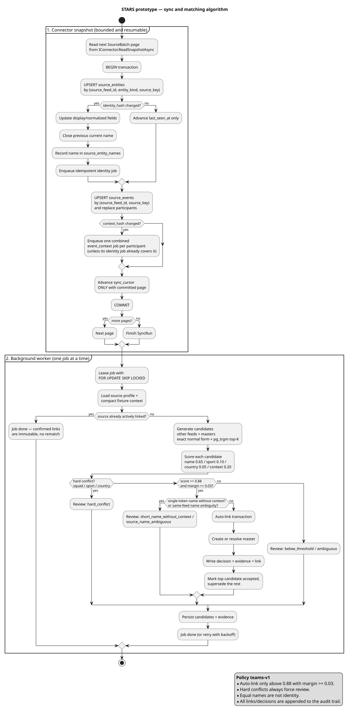
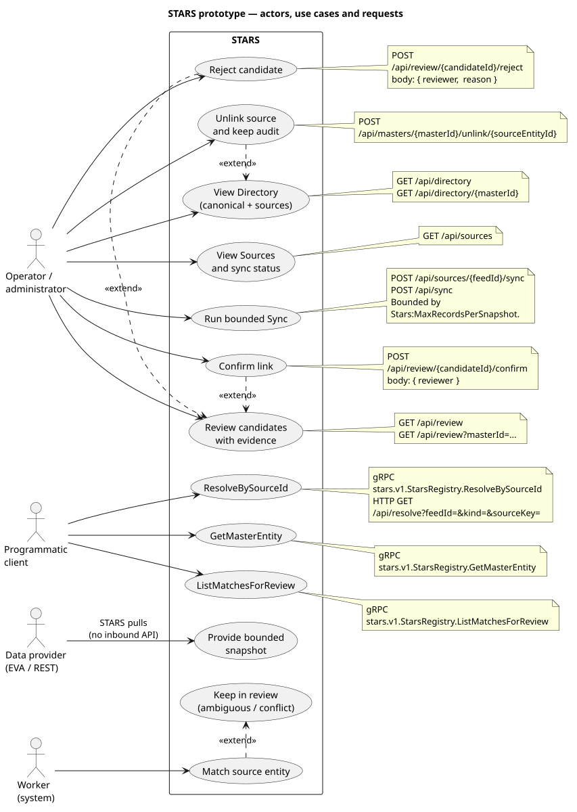
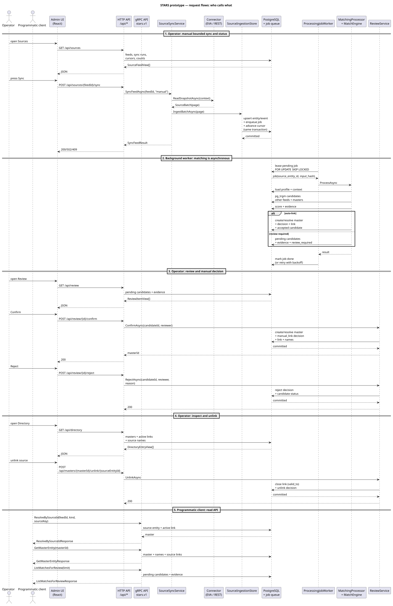
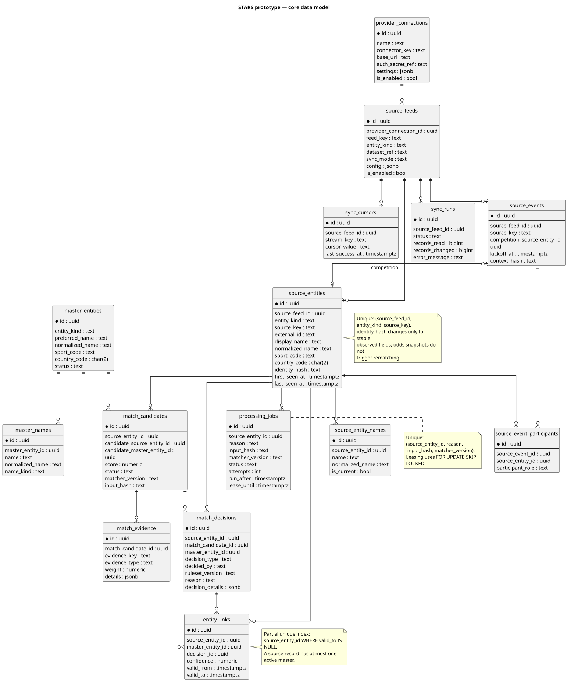

# STARS diagrams (PlantUML)

Source files are `.puml`; rendered `.svg` files are committed for GitHub preview.
PlantUML is the source of truth. Edit the `.puml` file and re-render the SVG.

| Diagram | What it answers |
| --- | --- |
| [01-system-components](01-system-components.puml) | What the system is made of and which component talks to which |
| [02-deployment](02-deployment.puml) | What runs where: browser, API container, PostgreSQL, providers |
| [03-sync-and-matching](03-sync-and-matching.puml) | The ingestion + scoring + decision algorithm end to end |
| [04-use-cases](04-use-cases.puml) | Who can do what: operator, client, provider, worker |
| [05-request-flows](05-request-flows.puml) | Concrete HTTP/gRPC request sequences per scenario |
| [06-data-model](06-data-model.puml) | Core Source Registry / Master Registry tables and invariants |

## System components



## Deployment



## Sync and matching algorithm



## Use cases



## Request flows



## Data model



## Who calls what

| Actor | Interface | Request | Result |
| --- | --- | --- | --- |
| Operator | Admin UI → HTTP | `GET /api/sources` | feeds, cursors, last run, counts |
| Operator | Admin UI → HTTP | `POST /api/sources/{feedId}/sync` | one bounded sync run |
| Operator | Admin UI → HTTP | `POST /api/sync` | sync all enabled feeds |
| Operator | Admin UI → HTTP | `GET /api/directory` | canonical teams and their source records |
| Operator | Admin UI → HTTP | `GET /api/directory/{masterId}` | master + open reviews |
| Operator | Admin UI → HTTP | `GET /api/review` | pending candidates + evidence |
| Operator | Admin UI → HTTP | `POST /api/review/{candidateId}/confirm` | master id, manual link, audit decision |
| Operator | Admin UI → HTTP | `POST /api/review/{candidateId}/reject` | rejected candidate, audit decision |
| Operator | Admin UI → HTTP | `POST /api/masters/{masterId}/unlink/{sourceEntityId}` | closed link, audit decision |
| Operator | HTTP | `GET /api/metrics` | job/queue/registry counters |
| Programmatic client | gRPC | `ResolveBySourceId` | master for a provider source key |
| Programmatic client | gRPC | `GetMasterEntity` | canonical names + all source links |
| Programmatic client | gRPC | `ListMatchesForReview` | pending review items |
| Programmatic client | HTTP | `GET /api/resolve?feedId=&kind=&sourceKey=` | same resolve view over HTTP |
| Provider | Connector pull | `ReadSnapshotAsync` | `SourceBatch` pages; no inbound provider API |
| Worker | PostgreSQL queue | lease / process / retry | candidate, evidence, link or review |
| Worker | PostgreSQL | `FOR UPDATE SKIP LOCKED` | one job lease at a time |

## Render

Whole folder:

```bash
plantuml -tsvg docs/diagrams/*.puml
```

Or with Docker:

```bash
docker run --rm -v "$PWD/docs/diagrams:/data" plantuml/plantuml -tsvg /data/*.puml
```

VS Code: install the **PlantUML** extension and use `Alt+D` / preview. The rendered file
name is taken from the diagram title; rename it if you change a title.

## Maintenance rules

- Keep diagram labels in sync with class names and endpoint paths.
- Do not put thresholds in two places: update both the diagram and
  [architecture.md](../architecture.md).
- Do not add secrets or real provider tokens to diagrams.
- Inner component arrows show logical calls, not deployment protocol; protocol labels
  live on the external arrows.
